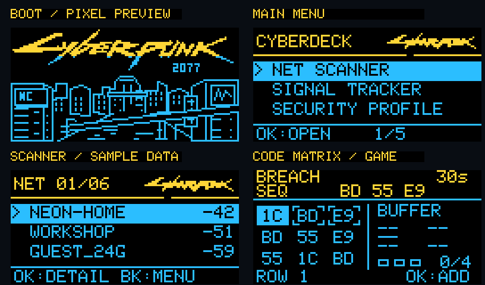
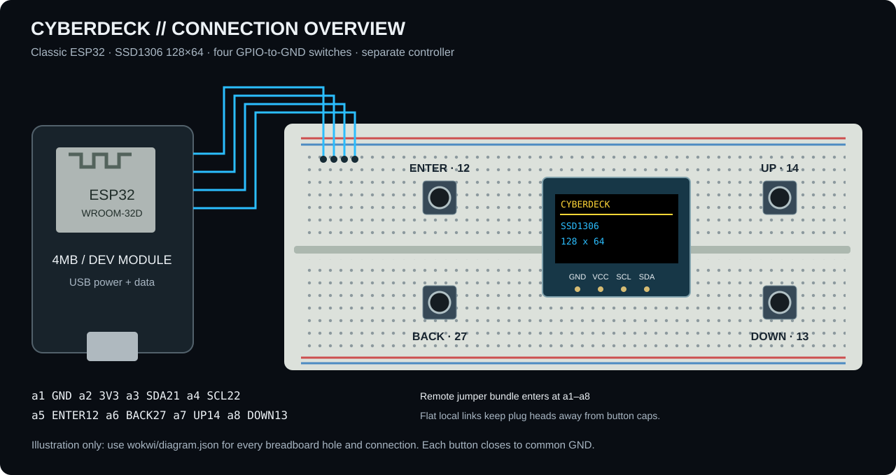
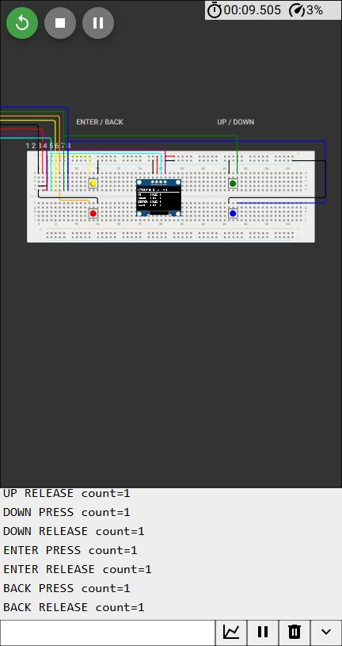

# ESP32 Cyberdeck

**جهاز OLED صغير لفحص شبكات Wi-Fi وإشاراتها، بأربعة أزرار وصفحة محلية للرسم من الجوال.**

[English](README.md) · [التوصيلات](docs/HARDWARE.md) · [البناء والرفع](docs/BUILD.md) · [نتائج التحقق](docs/VALIDATION.md)



الواجهة مستوحاة من Cyberpunk وتعمل ضمن قيود الشاشة الفعلية: **128×64، لون بت واحد، ومخزن رسم 1024 بايت**. الصفوف 0–15 تظهر بالأصفر والبقية بالأزرق بحسب الشاشة؛ المعاينة لا تتعامل معها كشاشة RGB.

## شاهد المعاينة


**المقطع معاينة متصفح ببيانات شبكات تجريبية، وليس تصويرًا لتشغيل الكود على ESP32.** بعد تنزيل المشروع، افتح [ملف المعاينة](preview/power/power-preview.html) بالمتصفح، واضغط «تشغيل الجهاز». ↑ ↓ Enter Esc للتحكم. عرض الملف داخل GitHub وحده لا يشغّل المعاينة.

## المميزات

- إقلاع 10 ثوانٍ بدون لودنق، ظهور من المنتصف، وقلتش واضح للشعار كل ثانيتين. الإطفاء يطوي الصورة إلى خط ثم نقطة.
- **NET SCANNER:** فحص فعلي لشبكات 2.4GHz على الهاردوير، مع SSID وRSSI والقناة والاحتفاظ بأقوى 32 نقطة وصول.
- **SIGNAL TRACKER:** رسم لقوة الإشارة المقاسة من BSSID المختار. عند فقد الشبكة تظهر LAST/LOST؛ لا يولّد الهاردوير موجة وهمية.
- **SECURITY PROFILE:** اسم الشبكة وBSSID والتشفير المعلن والقناة والإشارة. لا يفك التشفير ولا ينفذ اختراقًا.
- **SYSTEM MONITOR:** الذاكرة ووقت تشغيل التطبيق وحالة AP/STA من ESP32.
- صفحة جوال محلية للرسم والنص الإنجليزي ومراقبة الأزرار ونتائج الفحص. الرسم أو الرسالة يظهران 20 ثانية.
- لعبة مستقلة بمصفوفة Hex ‏3×3، وBuffer بأربع خانات، واختيار صف/عمود بالتناوب، ومؤقت 30 ثانية.

**تعداد الأجهزة المتصلة داخل الشبكة غير مضاف في هذا الإصدار.**

## المكونات والتوصيلات

تحتاج ESP32-WROOM-32D، وشاشة SSD1306 I²C بدقة 128×64 وعنوان 0x3C، وأربعة أزرار، وبريدبورد وأسلاك وكابل USB بيانات.



| المكون | التوصيل |
|---|---|
| OLED SDA | GPIO21 |
| OLED SCL | GPIO22 |
| OLED VCC / GND | 3V3 / أرضي مشترك |
| UP — أعلى اليمين | GPIO14 |
| DOWN — أسفل اليمين | GPIO13 |
| ENTER — أعلى اليسار | GPIO12 |
| BACK / التشغيل — أسفل اليسار | GPIO27 |

كل زر بين GPIO وGND، ويعمل `INPUT_PULLUP`. المعالجة تزيل الاهتزاز لمدة 30ms. الشاشة والأزرار على البريدبورد، وESP32 منفصل، ومداخل الجمبر بعيدة عن الأصابع. [دليل الترتيب الدقيق](docs/HARDWARE.md).



هذه صورة **اختبار التوصيلات والشاشة والأزرار السابق في Wokwi**. لا تمثل اختبارًا للمشروع الكامل أو لفحص Wi-Fi الحقيقي داخل المحاكي.

## الرفع على ESP32

1. نزّل المشروع ZIP أو استخدم Git.
2. ثبّت منصة **esp32 by Espressif Systems** في Arduino IDE؛ الإصدار الذي جرى التحقق به **3.3.12**.
3. افتح [Cyberdeck_Hardware.ino](firmware/Cyberdeck_Hardware/Cyberdeck_Hardware.ino) داخل مجلده.
4. اختر **ESP32 Dev Module**، وFlash ‏4MB، والتقسيم الافتراضي، وPSRAM معطل، وحدد المنفذ ثم ارفع. سرعة Serial Monitor هي **115200**.

الملف الموحّد كامل. لا يحتاج نسخ هيدرات خاصة أو مكتبات Adafruit أو رفع ملفات إلى SPIFFS. المكتبات المطلوبة Wire وWiFi وWebServer تأتي مع منصة ESP32. [أوامر Arduino CLI](docs/BUILD.md).

## طريقة الاستخدام

UP وDOWN للتنقل، وENTER للفتح والتأكيد. BACK القصير يرجع **عند تحرير الزر**. اضغط BACK نحو ثانيتين للإطفاء البرمجي، ومرة أخرى لتشغيله. عند توصيل الطاقة يبدأ الإقلاع تلقائيًا، ولا تتجاوزه أزرار التنقل.

الإطفاء البرمجي يوقف OLED وWi-Fi والسيرفر، مع بقاء ESP32 موصولًا بالطاقة لقراءة الزر؛ ليس فصلًا كهربائيًا ولا Deep Sleep. عند التشغيل تعود الشبكة، وقد تحتاج إعادة اتصال الجوال. RESET/EN يعيد تشغيل المتحكم. لا تحتاج زرًا خامسًا.

## صفحة الجوال

اتصل بشبكة **ESP32-LAB** بكلمة المرور الافتراضية المنشورة **Lab32-2026**، وافتح **http://192.168.4.1** باستخدام HTTP. اختر البقاء على الشبكة إذا قال الهاتف إنها بلا إنترنت. غيّر الكلمة في Config لنسختك.

يمكنك الرسم على بكسلات الشاشة، إرسال نص إنجليزي، ومراقبة الأزرار ونتائج الشبكات. وقت الإقلاع والإطفاء تُرفض طلبات تغيير العرض والفحص بحالة HTTP 423، وأثناء اللعبة النشطة بحالة 409. الراديو الواحد في AP+STA قد يسبب تأخرًا أو انقطاعًا قصيرًا أثناء الفحص.

## التطوير والاختبارات

تحتاج Node.js 20 أو أحدث، دون مكتبات npm إضافية:

```sh
npm run build
npm test
```

عدّل الملفات المنظمة في `firmware/cyberdeck/` وصفحة الجوال في `web/index.html`، ثم أعد البناء لتحديث الملف الموحّد. مصدر المعاينة في `preview/`. لإنتاج الصور والمقطع من جديد ثبّت FFmpeg وشغّل `npm run media`.

| المسار | المحتوى |
|---|---|
| `firmware/` | ملف Arduino الجاهز والمصدر المنظم |
| `preview/` | معاينة تفاعلية مستقلة ومصدرها |
| `web/` | صفحة الجوال التي تدمج داخل الكود |
| `wokwi/` | مخطط البريدبورد وكود اختبار الشاشة والأزرار |
| `docs/` | التوصيلات والبناء والتحقق والصور |
| `tests/` | اختبارات الصفحة وتحققات C++ |
| `tools/` | أدوات البناء وتوليد المراجع وفحص المستودع |

ترجمت نسخة HW2 بنجاح على Arduino ESP32 3.3.12: ‏**1,037,060 بايت Flash ‏(79%)** و**56,464 بايت globals ‏(17%)**. تشمل الاختبارات 8 مجموعات للمعاينة و18 لصفحة الجوال و13 تحققًا وقت ترجمة C++. التفاصيل وحدود الاختبار في [دليل التحقق](docs/VALIDATION.md).

لم يُدّع تشغيل الكود على ESP32 فعليًا أو نجاح محاكاة المشروع الكامل. المراجع الرسومية المولدة ليست مقارنة C++ منفذة. ملف GitHub Actions جاهز لتشغيل الاختبارات عند الرفع؛ لا يُعد وجوده نجاحًا لتشغيل سحابي لم يحدث بعد.

## الترخيص

الكود الأصلي تحت [MIT](LICENSE)، مع حفظ [ترخيص خط Adafruit](LICENSES/Adafruit-GFX-BSD.txt). شعار Cyberpunk المرجعي **مستثنى من MIT** ولم تثبت حقوق إعادة توزيعه؛ راجع [إشعارات الطرف الثالث](THIRD_PARTY_NOTICES.md). لاستعمال حزمة تكون كل أصولها بترخيص مفتوح مثبت، استبدل الشعارين بعمل أصلي.
