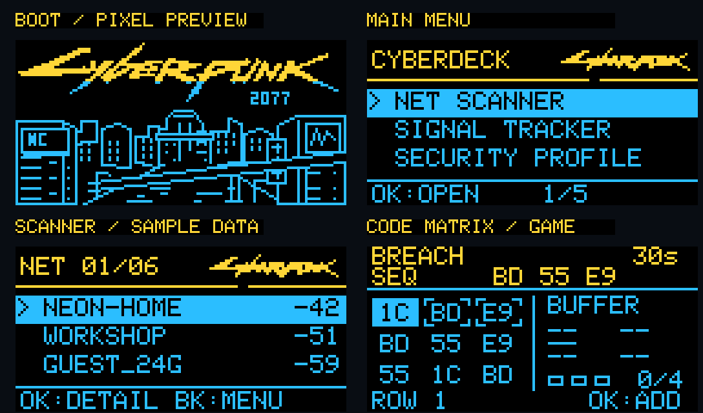
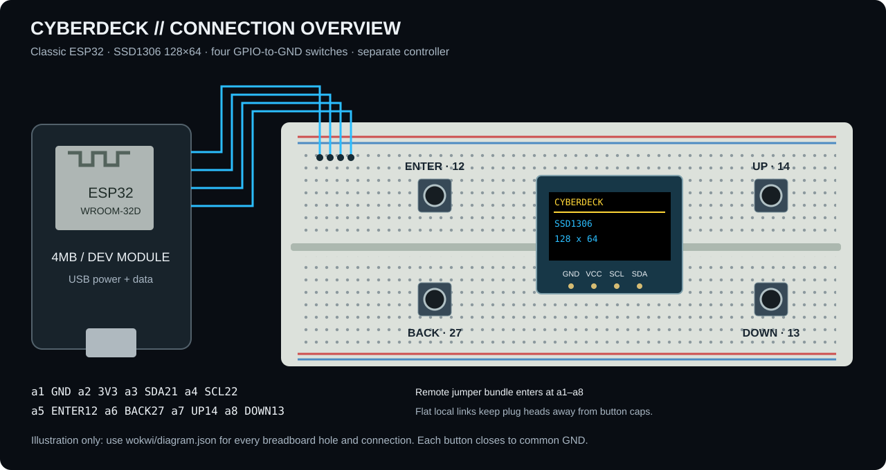
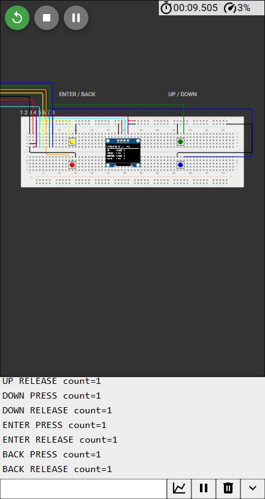

# ESP32 Cyberdeck

**A pocket OLED cyberdeck with real 2.4GHz Wi-Fi diagnostics, four buttons and a local phone drawing interface.**

[العربية](README.ar.md) · [Hardware & wiring](docs/HARDWARE.md) · [Build & upload](docs/BUILD.md) · [Validation](docs/VALIDATION.md) · [Contributing](CONTRIBUTING.md)



The interface draws into a real **128×64, 1-bit / 1024-byte framebuffer**. It targets an ESP32-WROOM-32D and an SSD1306 with a fixed yellow top band and blue lower area. The Cyberpunk-inspired presentation is an independent hobby project.

## See it move


**This animation is the browser preview with fictional networks, not a recording of the firmware running on an ESP32.** Open [power-preview.html](preview/power/power-preview.html) after downloading the repository to try the buttons yourself; GitHub's code viewer does not execute HTML. Click the power button, then use ↑ ↓ Enter Esc.

## Features

- **Startup and soft power:** a 10-second center-opening animation without a loading bar; a center-collapse shutdown; a stronger logo glitch every two seconds.
- **NET SCANNER:** actual 2.4GHz Wi-Fi survey on hardware, SSID/RSSI/channel, up to 32 strongest BSSIDs, and network details.
- **SIGNAL TRACKER:** measured RSSI history for the selected BSSID. Missing targets are marked LAST/LOST; firmware does not synthesize signal samples.
- **SECURITY PROFILE:** advertised authentication, BSSID, channel and RSSI. It does not decrypt traffic or establish whether a network is secure.
- **SYSTEM MONITOR:** free/total heap, application uptime and AP/STA state.
- **Phone web interface:** your own local access point, live button states, scan results, English text, and a touch drawing canvas. A sent drawing or message stays for 20 seconds.
- **Code-matrix minigame:** 3×3 hex grid, four buffer slots, alternating row/column choices and a 30-second timer. This is a standalone game, not network intrusion.

LAN client discovery/device enumeration is **not implemented** in this release.

## Parts

| Part | Quantity |
|---|---:|
| ESP32-WROOM-32D / classic ESP32 Dev Module, 4MB flash | 1 |
| SSD1306 I²C OLED, 128×64, address 0x3C | 1 |
| Momentary pushbutton | 4 |
| Full-size breadboard, jumper wires, USB data cable | As needed |

## Wiring



| Connection | ESP32 pin |
|---|---|
| OLED SDA | GPIO21 |
| OLED SCL | GPIO22 |
| OLED VCC / GND | 3V3 / common GND |
| UP — upper right | GPIO14 |
| DOWN — lower right | GPIO13 |
| ENTER — upper left | GPIO12 |
| BACK / soft power — lower left | GPIO27 |

Each button connects its GPIO to GND and uses `INPUT_PULLUP`. See [the exact breadboard layout](docs/HARDWARE.md) for the remote jumper inputs and finger clearance.

<details>
<summary>Actual Wokwi wiring screenshot</summary>



This screenshot is from the earlier **screen/button wiring test**. The complete HW2 firmware and real Wi-Fi behavior have not been validated in Wokwi.

</details>

## Upload in Arduino IDE

1. Download the repository ZIP or clone it.
2. Install **esp32 by Espressif Systems**; the validated version is **3.3.12**.
3. Open [`firmware/Cyberdeck_Hardware/Cyberdeck_Hardware.ino`](firmware/Cyberdeck_Hardware/Cyberdeck_Hardware.ino).
4. Select **ESP32 Dev Module**, 4MB flash, default partitions and PSRAM disabled. Choose your board's port and upload. Serial Monitor: **115200**.

The combined sketch is complete: no additional private headers, Adafruit library, filesystem image, SPIFFS or external web assets are required. WiFi, Wire and WebServer come with the ESP32 core. [CLI build instructions](docs/BUILD.md) are also included.

## Controls

| Action | Control |
|---|---|
| Previous / next item | UP / DOWN |
| Open / confirm | ENTER |
| Back | Short BACK, committed when released |
| Soft off / wake | Hold BACK for about 2 seconds |

Startup runs automatically when USB power is applied. Navigation cannot skip its 10 seconds. Soft off disables the OLED, Wi-Fi and HTTP server; the microcontroller remains powered to read BACK. Wake restores the access point; reconnect your phone if needed. RESET/EN resets the ESP32. No extra power button is required.

## Phone page

Connect to **ESP32-LAB** using the published default password **Lab32-2026**, then open **http://192.168.4.1** using HTTP. Choose to remain connected if your phone reports “no internet.” Change the default password in `Config` for your own build.

The page lets you draw individual OLED pixels, send printable English text, view button states and list scan results. During startup/shutdown, display writes and scan requests return HTTP 423; an active code-matrix game blocks those changes with HTTP 409. AP+STA shares one radio, so a survey may briefly delay or interrupt a phone connection.

## Develop

Node.js 20+ is sufficient for the preview, build tools and software tests. There are no npm dependencies to install.

```sh
npm run build
npm test
```

Edit the structured firmware in `firmware/cyberdeck/`, or the phone page in `web/index.html`, then rebuild the complete sketch. The browser preview sources are in `preview/base/` and `preview/power/`. To regenerate documentation images, install FFmpeg and run `npm run media`.

```text
firmware/  Complete Arduino sketch + structured C++ source
preview/   Interactive offline preview and source
web/       Phone page embedded into firmware
wokwi/     Breadboard diagram + standalone screen/button test
docs/      Wiring, upload steps, validation and images
tests/     Phone UI tests + C++ compile-time assertions
tools/     Portable builders, reference generator and checks
```

## Validation status

The delivered HW2 firmware was compiled with Arduino ESP32 3.3.12: **1,037,060 bytes flash (79%)**, **56,464 bytes global RAM (17%)**. The software checks cover 8 preview groups, 18 phone-page groups and 13 C++ compile-time assertions. Repository-specific checks and their current results are in [VALIDATION.md](docs/VALIDATION.md).

No physical ESP32 execution is claimed. The Wokwi screenshot demonstrates the earlier wiring test; it is not proof of a full-firmware simulation. Generated reference frames are fixtures, not a completed C++ pixel comparison. The included GitHub Actions workflow is configuration, not a successful cloud run until GitHub actually executes it.

## License

Project code is [MIT](LICENSE). The bitmap font retains [Adafruit's BSD notice](LICENSES/Adafruit-GFX-BSD.txt). The user-supplied Cyberpunk reference logo is **excluded from MIT**; see [THIRD_PARTY_NOTICES.md](THIRD_PARTY_NOTICES.md). Replace those logo bitmaps for a distribution requiring every asset to have an established open license.
