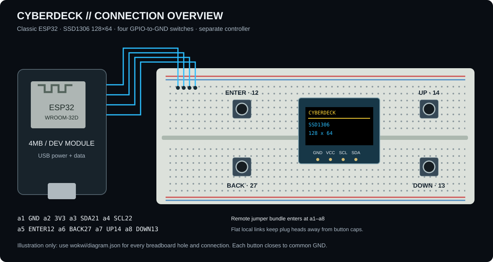
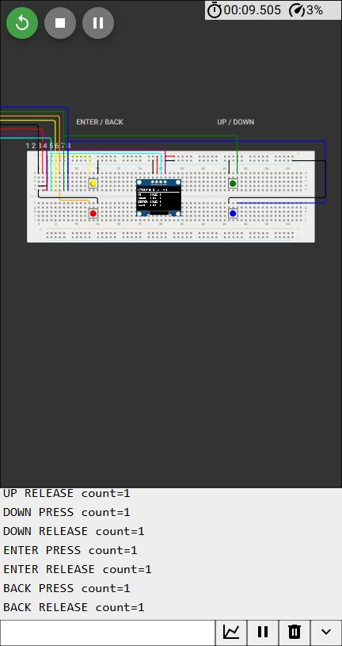

# Hardware and wiring / الهاردوير والتوصيلات

[README](../README.md) · [العربية](../README.ar.md)

The drawing above is an explanatory wiring illustration. The authoritative breadboard holes and connections are in [`wokwi/diagram.json`](../wokwi/diagram.json).

## Electrical connections

| Signal | ESP32 GPIO / power | Notes |
|---|---|---|
| OLED SDA | 21 | I²C data |
| OLED SCL | 22 | I²C clock |
| OLED VCC | 3V3 | Common 3.3V supply |
| OLED GND | GND | Common ground |
| UP | 14 | Upper-right button |
| DOWN | 13 | Lower-right button |
| ENTER | 12 | Upper-left button |
| BACK / soft power | 27 | Lower-left button; hold about two seconds |

Each button closes its GPIO to GND and is configured `INPUT_PULLUP`. No external pull-up resistor is needed. Stable LOW is a press, and debounce is 30ms. The target SSD1306 address is 0x3C and the configured I²C clock is 400kHz.

The OLED is binary: software selects lit/unlit pixels. The yellow/blue split is fixed by the physical panel: rows 0–15 yellow, 16–63 blue. Use a 128×64 SSD1306 I²C panel; a different controller or resolution needs code changes.

## Practical breadboard arrangement

الشاشة والأزرار الأربعة على البريدبورد، وESP32 خارجه إلى اليسار. مداخل حزمة الدوبونت في a1 إلى a8 بأقصى اليسار، ثم وصلات محلية قصيرة ومسطحة إلى الشاشة والأزرار. الزران السفليان منقولان صفًا إلى الأسفل كي تكون نقاط السلك فوقهما، وتبقى المساحة تحت الإصبع خالية من رؤوس الجمبر.

| Remote input / مدخل الحزمة | Destination |
|---|---|
| a1 | GND |
| a2 | 3V3 |
| a3 | SDA / GPIO21 |
| a4 | SCL / GPIO22 |
| a5 | ENTER / GPIO12 |
| a6 | BACK / GPIO27 |
| a7 | UP / GPIO14 |
| a8 | DOWN / GPIO13 |

| Button | Contact groups | Local signal / ground hole |
|---|---|---|
| ENTER | b15/e15 and b13/e13 | a13 / a15 |
| BACK | g15/j15 and g13/j13 | f13 / f15 |
| UP | b48/e48 and b46/e46 | a48 / a46 |
| DOWN | g48/j48 and g46/j46 | f48 / f46 |

OLED pins occupy c28..c31 in the layout: GND, VCC, SCL, SDA. Supply rails are bridged as specified in the diagram. Use the netlist rather than guessing connectivity from a wire's visible route; the physical insertion hole matters.

## Wokwi files and scope

- [`diagram.json`](../wokwi/diagram.json): exact component placement and wiring.
- [`sketch.ino`](../wokwi/sketch.ino): standalone screen/button wiring test, not the full cyberdeck firmware.
- [`validate.mjs`](../wokwi/validate.mjs): software connectivity check for the eight isolated inputs, OLED, each button closure and lower jumper positions.

Run `npm run test:wiring` locally. To inspect in Wokwi, create a new ESP32 project and copy the diagram and wiring-test sketch. No public Wokwi project has been created for this repository.

The screenshots come from the earlier wiring test, where each of UP/DOWN/ENTER/BACK produced PRESS and RELEASE with count=1. They do not validate the full HW2 firmware, RF scanning or mechanical finger clearance. These need your own device tests.

## GPIO12 on a classic ESP32

The project retains GPIO12 for ENTER to match the existing wiring. Follow the supplied GPIO-to-GND button arrangement; do not connect the button signal to a power rail. Different ESP32 families have different pin and boot constraints and are not drop-in targets for this sketch.
